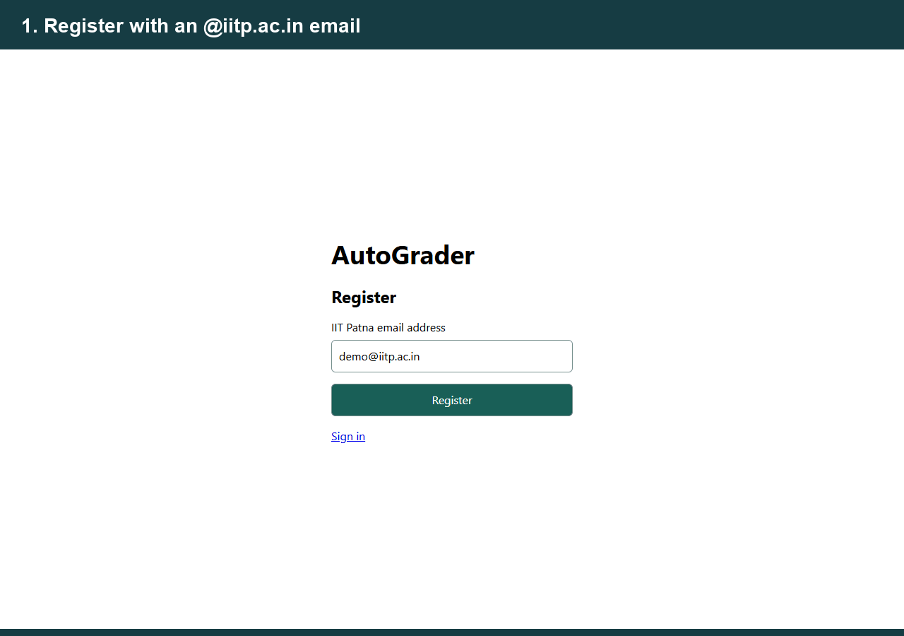
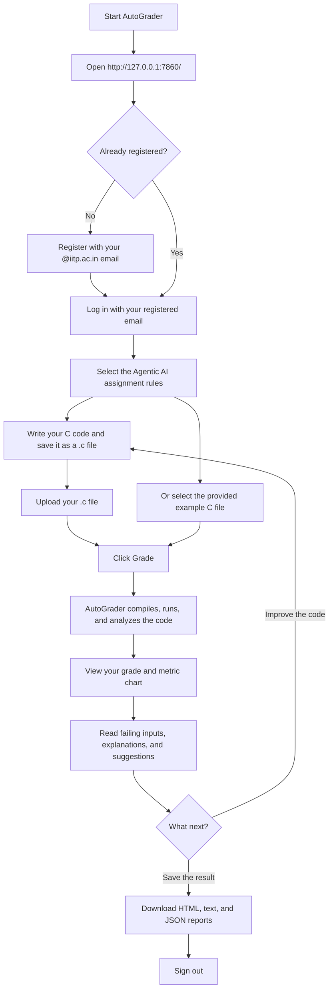

# AutoGrader

AutoGrader evaluates student C programs using instructor-editable rules. It compiles
and runs each submission under resource limits, coordinates nine analyzers, and
produces a weighted grade with evidence, suggestions, and a visual result.

This project implements the **AutoGrader: A Rule-Driven Evaluator for C Programs**
assignment. The [assignment brief](problems/agentic_ai/assignment.pdf), example C
submission, rules, reference solution, and test cases are included.

## Team Everest

Computer Science & Engineering, IIT Patna.

| Contributor | Roll number |
|---|---|
| Roshan Jha | 2611CS23 |
| Shivanshu Raj | 2611CS26 |
| Mantosh Ravi | 2611CS09 |
| Kanishk Mishra | 2611CS20 |

Repository: [Roshanzha/AutoGrader](https://github.com/Roshanzha/AutoGrader)

## Watch AutoGrader in action



The animated walkthrough shows a real local run of the assignment example,
ending with **82.3 / 100**, per-metric analysis, and HTML, text, and JSON downloads.
Pauses are condensed; the animation is not a grading-speed benchmark.
Registration and login use an `@iitp.ac.in` email address without mailbox verification.

## Project review materials

- [15-slide Team Everest presentation](docs/presentation/AutoGrader_Team_Everest.pptx)
  — includes the demo GIF on slide 4; use PowerPoint Slide Show mode to animate it.
- [Download the workflow GIF](docs/media/AutoGrader_Workflow.gif)
- [Six-page IEEE-format project report](docs/report/AutoGrader_IEEE_Conference.pdf)
- [LaTeX report source and figures](docs/report/source/)

To save the complete project from GitHub, choose **Code → Download ZIP**, extract
the archive, and follow the setup instructions below. The ZIP includes the source,
assignment, sample reports, and review materials. Python packages and system tools
are installed during setup; they are not bundled in the archive.

## Features

- Compile checks, smoke execution, and static sanity checks before specialist analysis.
- External JSON rules for metrics, thresholds, weights, and execution limits.
- Correctness, compiler warnings, structure, modularity, edge cases, complexity,
  memory safety, readability, and originality analysis.
- Counterexamples with expected and actual output, explanations, and suggestions.
- An overall grade, per-metric chart, expandable evidence, and instructor flags.
- Downloadable HTML, text, and JSON reports with usefulness and limitations.
- Light and dark themes, email-only registration, sign-in, and sign-out.
- Optional local Ollama integration for readability, explanations, extra test inputs,
  and comparison against generated solutions.

## Requirements

| Component | Requirement |
|---|---|
| Operating system | Ubuntu/Debian Linux, or Windows with Ubuntu in WSL2 |
| Python | Python 3.10 or newer, with venv and pip |
| C toolchain | GCC, standard C headers, and sanitizer runtimes, installed through build-essential |
| Static analysis | cppcheck, installed by the launcher |
| Python libraries | Packages in requirements.txt, including Gradio and Requests |
| Internet | Needed for initial package downloads and optional model downloads |
| Browser | A current browser for the web interface |
| Optional AI | Ollama and a locally downloaded model, with sufficient RAM for that model |

The runner uses Linux Bash, process groups, and resource limits. Windows setup uses
WSL2 for execution. On macOS, run the project inside an Ubuntu virtual machine.
The installation and verification below cover Linux and Windows/WSL.

## Install on Windows

### 1. Set up Ubuntu

Open PowerShell as Administrator and run:

```powershell
wsl --install -d Ubuntu
```

Restart Windows if requested. Open Ubuntu and complete the first-run setup by
creating a Linux username and password.

If WSL reports that virtualization is disabled:

1. Enable Intel Virtualization Technology / VT-x or AMD-V / SVM in BIOS/UEFI.
2. Run `wsl --install --no-distribution` from Administrator PowerShell.
3. Restart Windows and retry `wsl --install -d Ubuntu`.
4. Confirm that `wsl --list --verbose` lists Ubuntu with version 2.

### 2. Get the project

Install Git for Windows if you use the clone command. In PowerShell, open the
folder where you want to keep the project and run:

```powershell
git clone https://github.com/Roshanzha/AutoGrader.git
cd AutoGrader
```

Alternatively, use **Code → Download ZIP** on GitHub and extract the ZIP before
starting the app.

### 3. Start AutoGrader

Double-click `Start-AutoGrader.cmd`, or run:

```powershell
.\Start-AutoGrader.cmd
```

On the first launch, the script installs Linux build tools and Python packages
and creates `.venv-linux`. Enter your Ubuntu password if sudo asks for it.
Password characters are hidden while typing. Initial installation can take
several minutes, especially when the project is on a Windows drive.

Keep the console open and visit **http://127.0.0.1:7860/**.
Later launches reuse the environment. Press Ctrl+C in the console to stop.
The older `Start-GraderGent.cmd` launcher forwards to `Start-AutoGrader.cmd`.

The launcher targets a WSL distribution named `Ubuntu`. For a differently named
Ubuntu distribution, open that distribution, change to the project directory,
and run `bash run-local.sh`.

## Install on Ubuntu / Debian

Open a terminal and run:

```bash
sudo apt-get update
sudo apt-get install -y git build-essential cppcheck python3-venv python3-pip
git clone https://github.com/Roshanzha/AutoGrader.git
cd AutoGrader
bash run-local.sh
```

Open **http://127.0.0.1:7860/** and keep the terminal running.

For manual setup instead of the launcher:

```bash
python3 -m venv .venv-linux
.venv-linux/bin/python -m pip install -r requirements.txt
.venv-linux/bin/python front_app.py
```

Run commands from the repository root. The web app imports FastAPI, Uvicorn,
and python-multipart, which are installed with Gradio.

## Register, sign in, and grade

### User workflow

Follow the arrows from opening AutoGrader to downloading your result.
GitHub renders this Mermaid diagram directly in the README.



Quick path: **Start → Register → Log in → Select rules → Upload C file → Grade → View analysis → Download reports → Sign out**.

1. Open http://127.0.0.1:7860/ and select **Register**.
2. Register an email address ending in `@iitp.ac.in`.
3. Sign in using the registered address.
4. Select **Agentic AI assignment**, the default rules preset.
5. Upload a `.c` file, or click the included assignment example.
6. Click **Grade**.
7. Read the chart, result analysis, test evidence, findings, suggestions, and flags.
8. Download the HTML, text, and JSON reports. Use **Sign out** when finished.

**Access model:** this local demo uses email-only login. It checks the address
format and registration. Anyone who knows a registered address can sign in.
Mailbox verification and passwords are absent. Sessions expire after eight
hours or a server restart.

Accounts persist in `~/.local/share/autograder/accounts.sqlite3` inside Linux.
A new computer has its own account database. Registration is required there.
The web session gates the grader, API, uploads, and downloads. CLI grading is
available directly from the local terminal.

## Command-line grading

From Ubuntu or a Linux terminal in the repository:

```bash
# Assignment example and default assignment rules
bash run-local.sh --cli problems/agentic_ai/add.c

# All included sample submissions using the assignment rules
.venv-linux/bin/python front_app.py --cli samples/*.c --rules rules/agentic_ai.json

# Original mathematical-sum exercise
.venv-linux/bin/python front_app.py --cli samples/add_clean.c --rules rules/add_rules.json
```

From Windows PowerShell:

```powershell
.\Start-AutoGrader.cmd --cli problems/agentic_ai/add.c
.\Start-AutoGrader.cmd --cli samples/add_basic.c samples/add_buggy.c --rules rules/agentic_ai.json
```

List files explicitly in PowerShell. The wildcard example above relies on Linux
shell expansion.

## Optional local AI with Ollama

Install Ollama inside the same Linux/WSL environment as AutoGrader:

```bash
sudo apt-get install -y curl
curl -fsSL https://ollama.com/install.sh | sh
ollama pull llama3.1
ollama list
```

If the Ollama service is inactive, run `ollama serve` in another terminal.
The configured endpoint is `http://localhost:11434`.

Edit the `llm` section in the selected rules file to choose an installed model:

```json
"llm": {
  "host": "http://localhost:11434",
  "model": "llama3.1",
  "temperature": 0,
  "seed": 42
}
```

The model must fit the available RAM. Downloading a model can require several GB.
When Ollama is unavailable, AutoGrader grades with heuristic readability and
analyzer-based explanations, skips AI-generated counter-tests and LLM-copy
comparison, and records `llm_unavailable` flags.

## Assignment grading rules

The default preset is [rules/agentic_ai.json](rules/agentic_ai.json).
It uses a one-second execution limit and a 64 MB address-space limit for ordinary
runs. Sanitizer runs disable the address-space cap because ASan reserves a large
virtual address range, and use a longer timeout.

| Metric | Weight | Analyzer | Rule or evidence |
|---|---:|---|---|
| Correctness | 20% | io_tests | Compare output against 10 supplied tests |
| Syntax | 10% | compiler_warnings | Count GCC warnings with the configured flags |
| Structure | 10% | static_analysis | Maximum cyclomatic complexity 8 and function length 40 |
| Modularity | 10% | function_split | At least 2 functions, including a called helper |
| Logical | 10% | edge_case_runner | Negative, zero, and overflow cases against the reference |
| Complexity | 10% | complexity_estimator | Required O(1), measured at sizes 1, 10, and 100 |
| Memory safety | 10% | sanitizer_run | AddressSanitizer, UndefinedBehaviorSanitizer, leak checks |
| Readability | 10% | llm_review | Local model review or documented heuristic fallback |
| Originality | 10% | similarity_flag | Token similarity against submissions/, threshold 0.85 |

Each analyzer produces a score from 0 to 1.

```text
grade = 100 × sum(weight × score) / sum(weights)
```

Weights are normalized if their sum differs from 1.0. The syntax analyzer removes
`-Werror` when counting warnings, so each warning can receive a penalty.
Corpus similarity flags affect originality points. LLM-copy flags are advisory.

### Overflow interpretation

The assignment preset follows the PDF's worked example and expects
`2147483647 1` to produce `-2147483648`. Its reference computes signed 32-bit
wrapping using safe wider arithmetic. A student's signed overflow can still
lose memory-safety points even when its printed result matches.

The original `rules/add_rules.json` preset expects the mathematical sum
`2147483648` instead. Select the intended preset before comparing results.

The PDF's sample grade is illustrative. This implementation computes grades
from actual analyzer evidence and the selected rules.

## Results and example outputs

Every grading run writes these files, using the submitted filename as the stem:

| File | Contents |
|---|---|
| reports/name.html | Offline chart, analysis, evidence, flags, and expandable findings |
| reports/name.txt | Student-readable grade, feedback, suggestions, usefulness, and limitations |
| reports/name.json | Structured scores, weights, evidence, hashes, and tool versions |

Repeated submissions with the same filename replace that filename's report files.
Save or rename downloaded reports when retaining multiple versions.

[Assignment sample reports](sample_reports/agentic_ai/) contain HTML, text, and
JSON outputs for all six included samples. They were generated with Ollama
unavailable. The [original sample reports](sample_reports/) use the earlier
mathematical-sum exercise.

### Repeatability

The assignment requires the same submission and rules to yield the same grade.
AutoGrader records source and rules hashes, fixes the LLM seed and temperature,
and caches model responses in `.cache/llm/`.

Strict repeatability across runs or computers remains a limitation. Timings,
compiler diagnostics, tool versions, model availability, and the originality
corpus can change scores. Keep those inputs consistent when comparing results.

## Architecture

```text
Browser → web_access.py → front_app.py
CLI ───────────────────→ front_app.py
                              ↓
                        coordinator.py
                              ↓
              Load rules → Compile / smoke / sanity
                              ↓
                    Independent analyzers
                              ↓
               Weighted grade + evidence + flags
                              ↓
           report_writer.py + result_analysis.py
                              ↓
                     HTML / text / JSON
```

Compilation failures and smoke timeouts produce partial reports. Execution-based
metrics are skipped while source-only analysis continues. The coordinator runs
independent analyzers concurrently and timing-sensitive analysis separately.

## Customize rules and problems

Paths inside rule files are relative to the project root. Update the external
JSON to change limits, weights, thresholds, model settings, or test locations.
Restart the web app after adding a new rule file so it appears in the dropdown.

| analyzer | params |
|---|---|
| `io_tests` | `testset_dir` |
| `compiler_warnings` | `flags`, `penalty_per_warning` (0.1) |
| `static_analysis` | `max_cyclomatic` (8), `max_function_length` (40), `penalty_per_violation`, `penalty_per_cppcheck` |
| `function_split` | `expect_helpers`, `min_functions` (2) |
| `edge_case_runner` | `cases` (names from `edge_cases`, or a `{name: [inputs]}` object), `llm_extra_cases` (0), `extra_cases_count_in_score` (false) |
| `complexity_estimator` | `required`, `sizes`, `input_pattern` (`two_ints_scaled`, `n_ints`, `count_then_ints`, `one_string`), `repeats` (3), `noise_floor_s` (0.02) |
| `sanitizer_run` | `flags`, `penalty_per_issue` (0.3) |
| `llm_review` | optional `model`, `temperature`, `seed`, `host` overrides |
| `similarity_flag` | `corpus_dir`, `flag_threshold` (0.85), `llm_baseline` (false), `llm_samples` (1), `llm_flag_threshold` (0.85) |

LLM behaviour is controlled by the plain-text prompts in `prompts/` (rubric, test designer,
explainer, solution writer) plus `llm` settings above.

### Adding a new problem
1. Create `problems/<name>/` with `statement.txt`, `reference.c`, `tests/NN.in` + `NN.out`.
2. Copy `rules/add_rules.json`, change paths, edge cases, weights.
3. For a problem with larger inputs, choose a matching `input_pattern` and big `sizes`
   for `complexity_estimator` (sizes that run for milliseconds, otherwise everything looks O(1)).
4. To catch copying from online sources, drop known solutions into the `corpus_dir` folder.

### Adding an analyzer (new metric)
Create `analyzers/my_metric.py`:

```python
NEEDS_EXECUTION = False          # True if it must run the compiled binary
def analyze(ctx, params):
    # ctx.source_text, ctx.binary_path, ctx.rules, ctx.get_llm(params), ctx.resolve(path) ...
    return {"score": 0.8, "evidence": {}, "feedback": "short note", "suggestions": []}
```
Then use `"analyzer": "my_metric"` in a rules file. It is discovered automatically.


## Usefulness and limitations

### Useful settings

| Use case | Concrete example |
|---|---|
| Programming labs | Evaluate 300 C submissions with per-metric feedback |
| Hiring practice | Compare correctness and memory safety across candidate solutions |
| Instructor review | Prioritize pairs flagged by similarity for human review |
| Student self-check | Find overflow or leaks before submitting an assignment |

### Limitations with concrete cases

| Limitation | Example of an unreliable verdict |
|---|---|
| Finite tests | A program hardcodes the ten expected answers and still passes those tests |
| Noisy timing | A bubble sort on tiny inputs appears constant-time because startup dominates |
| Similarity ambiguity | Two independently written short addition programs exceed the threshold |
| Subjective readability | Different models score the same source differently, or follow misleading source comments |

The report includes four usefulness examples and four limitations with suggested
mitigations. Corpus comparison requires reference files in `submissions/`.
Online source matching depends on a locally supplied corpus. Runtime profiling
with perf/oprofile and exhaustive coverage of all possible inputs remain future work.

### Execution and access boundaries

The runner limits buggy programs using wall time, CPU time, memory, output size,
and process-group termination. Submitted programs still run with the Linux user's
permissions. Use an isolated disposable environment for potentially malicious
code. The email-only login is suitable for the current local demonstration.
Deployment for a class needs stronger identity verification and isolation of
users' code and results.

## Troubleshooting

| Symptom | Action |
|---|---|
| WSL virtualization error | Enable virtualization in BIOS/UEFI and the Windows Virtual Machine Platform component, then restart |
| Ubuntu distribution missing | Run `wsl --list --verbose`, install Ubuntu, and complete its first-run setup |
| stdio.h missing / compilation fails for all samples | Run `sudo apt-get install -y build-essential` inside Ubuntu |
| pip or venv missing | Install `python3-venv python3-pip`, then rerun `bash run-local.sh` |
| ModuleNotFoundError | Use `.venv-linux/bin/python` and reinstall `-r requirements.txt` in that environment |
| Browser cannot connect | Keep the launcher open and wait for the server to start |
| Port 7860 already in use | Stop the earlier server or run `bash run-local.sh --port 7861` and open port 7861 |
| Sign-in rejects an address | Register first and use the exact `@iitp.ac.in` domain |
| Returned to sign-in | Sign in again after logout, session expiry, or a server restart |
| llm_unavailable | Check `ollama list`, the service, the model name, and the host in the selected rules |
| Linux script reports a carriage-return error | Restore LF line endings for run-local.sh, as specified by .gitattributes |

## Assignment submission process

The assignment brief specifies the following deliverables. Complete the remaining
course submission materials according to the instructor's schedule.

| Deliverable | Project location or required action |
|---|---|
| Working end-to-end agent | This repository and the installation steps above |
| Editable rules with an example | rules/agentic_ai.json and rules/add_rules.json |
| Output on sample submissions | sample_reports/agentic_ai/ |
| Usefulness and limitations | Generated reports and this README |
| Initial implementation plan | Prepare agentic01.pdf with plan, team workload, current progress, and timeline |
| Weekly progress evaluation | Demonstrate completed work and record remaining tasks each week |
| Final project report | Prepare the team's final report explaining methods, evidence, and limitations |
| GitHub code base and installation guide | Publish the current source, examples, and this README |
| 15–20 minute demonstration video | Record and upload to YouTube, then submit the link as instructed |

The assignment allows up to four members. The four contributors are listed above.
Workload assignments and completion dates should reflect the team's actual work.
Every member should be able to explain the code, grading methods, and report.

### Suggested demonstration sequence

1. Install on a fresh system and start AutoGrader.
2. Register, sign in, select the assignment rules, and grade the PDF's example.
3. Explain the weighted chart and show the overflow evidence.
4. Grade buggy, infinite-loop, and memory-leak samples.
5. Show JSON evidence and downloadable HTML/text reports.
6. Change a rule in the JSON, rerun, and explain the effect.
7. Discuss repeatability, usefulness, and the four concrete limitations.
8. Show each contributor's actual work and the repository.

## Publishing the updated project on GitHub

The repository remote is https://github.com/Roshanzha/AutoGrader.git.
From the project root, review the changes before committing:

```bash
git status
git diff -- README.md
git add README.md
git commit -m "Document installation, assignment workflow, and team contributors"
git push origin HEAD
```

These commands commit the README. Add the implemented source files, launchers,
rules, problem assets, and intended sample reports to a reviewed commit as well
so another computer can reproduce the documented setup. Check `git status` for
untracked files that have yet to be published.

Keep virtual environments, caches, account databases, logs, private submissions,
and personal generated reports out of commits. The existing .gitignore covers
the local virtual environments, .cache, Python bytecode, and log files.
